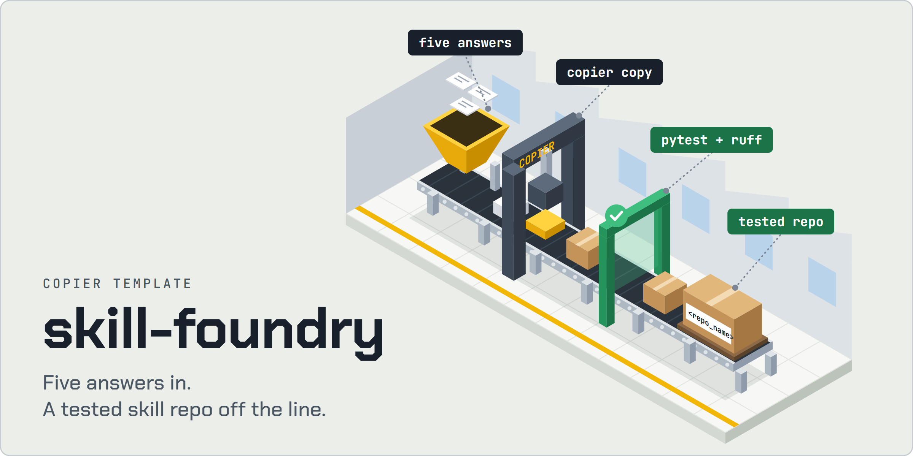
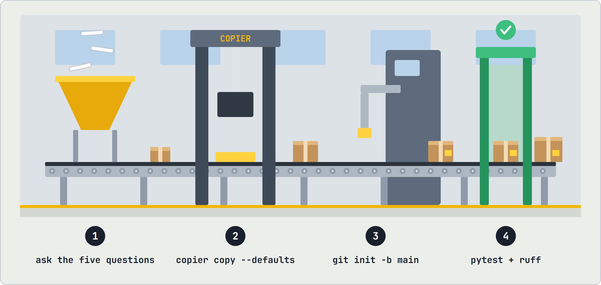
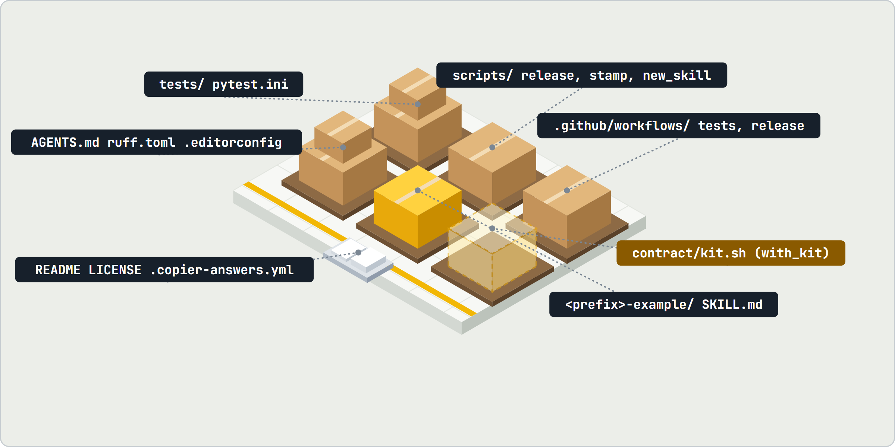
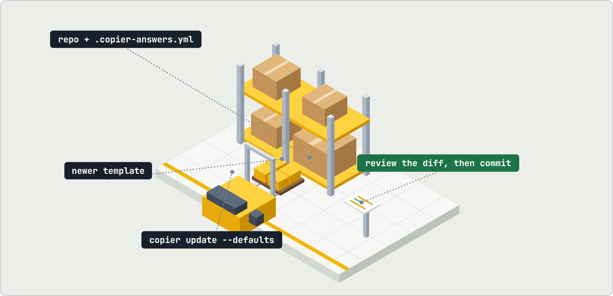

<h1 align="center"><picture><source media="(prefers-color-scheme: dark)" srcset="assets/hero-dark.webp"></picture></h1>

**Stop hand-building agent-skill repositories. Answer five questions and get one with tests, release scripts, rules, a formatter and CI already running.**

skill-foundry is a [copier](https://copier.readthedocs.io/) template for people who write agent skills. Every new skill family needs the same plumbing before the first real skill lands: a test harness that knows what a skill folder looks like, a version stamp, a release script, house rules, lint and CI on three operating systems. The foundry casts all of it in one command, so day one is spent on the skill, not on the scaffolding.

- **Tested from the first commit.** The generated suite checks every skill's shape, the writing conventions and the shared version, and it passes before you write a line.
- **Agent-ready.** An agent can run the whole thing without a single prompt by following a guide pinned to a release tag.
- **Stays current.** copier records your answers, so later foundry fixes merge into your repository with one command.

## How it works

<picture><source media="(prefers-color-scheme: dark)" srcset="assets/workflow-dark.webp"></picture>

1. **Ask.** Five questions decide the name, the skill prefix, the GitHub owner, the license and whether to add the shell kit.
2. **Cast.** `copier copy` renders the template with those answers, no prompts when `--defaults` and `--data` are passed.
3. **Init.** `git init -b main` turns the folder into a repository.
4. **Prove.** The generated pytest suite and ruff run green before anything else happens.

## What you get

<picture><source media="(prefers-color-scheme: dark)" srcset="assets/contents-dark.webp"></picture>

| Part | What it does |
|---|---|
| `tests/`, `pytest.ini` | skill shape, writing conventions (no typographic dashes, a warning on hard-wrapped paragraphs), one shared version |
| `scripts/release.py`, `scripts/stamp_version.py` | stamp every `<prefix>-*` skill with the release version and cut the release |
| `scripts/new_skill.py` | `uv run scripts/new_skill.py <name>` copies the example into a new skill at the current version |
| `.github/workflows/` | pytest on Ubuntu, macOS and Windows plus ruff; a read-only release check |
| `AGENTS.md`, `ruff.toml`, `.editorconfig`, `.gitattributes` | house rules for agents and humans, Conventional Commits with the skill name as scope |
| `<prefix>-example/` | a starter skill at version `0.0.0`, invoked by the user only, with `agents/openai.yaml` |
| `contract/kit.sh` (with `with_kit`) | a read-only POSIX shell kit, its packaged copy in the example skill and the tests that keep the two identical |
| `README.md`, `LICENSE`, `.copier-answers.yml` | the usage page, the license you picked, and the answers `copier update` reads |

## Quick start

```bash
uvx --from "copier>=9,<10" copier copy gh:the-khiem7/skill-foundry <destination>
```

copier asks five questions:

| Question | Default |
|---|---|
| `repo_name` | none; lowercase letters, digits and single hyphens |
| `skill_prefix` | `repo_name`; every skill folder is `<prefix>-<name>` |
| `github_owner` | `the-khiem7` |
| `license` | `MIT`; or `Apache-2.0`, `none` |
| `with_kit` | `true`; adds a read-only POSIX shell kit and its tests |

Then, inside the new repository:

```bash
git init -b main
uvx --from "pytest>=8,<10" --with pyyaml pytest tests/ -q
uvx --from "ruff>=0.6,<1" ruff check
uvx --from "ruff>=0.6,<1" ruff format --check
```

Only `uv` is needed. Nothing installs system-wide and nothing needs admin rights.

## Let an agent do it

Point the agent at the guide pinned to a release tag:

```text
https://raw.githubusercontent.com/the-khiem7/skill-foundry/v1.0.0/AGENT-GUIDE.md
```

The guide has the agent ask the five questions as labelled questions, check that the destination is empty, run copier with every answer passed explicitly, then run the suite and report each result.

## Stay in sync

<picture><source media="(prefers-color-scheme: dark)" srcset="assets/update-dark.webp"></picture>

When the foundry ships a fix, pull it into a generated repository with a clean working tree:

```bash
uvx --from "copier>=9,<10" copier update --defaults
```

copier merges the template changes since your recorded version. Review the diff and any conflict before you commit.

## Guardrails

- **No `--trust`, ever.** The template has no `_tasks`, so copier never runs commands from a remote template on your machine.
- **Pinned copier.** Major version 9 only, so a copier release cannot change the template syntax under you.
- **Pinned guide.** Agents read the guide through a tag, never through `main`, so nobody can change what every agent does by pushing to a branch.
- **Nothing outward.** Neither the guide nor the foundry pushes, creates a GitHub repository or commits on your behalf.

## Working on the foundry

| Path | What it is |
|---|---|
| `copier.yml` | the questions |
| `template/` | what a generated repository holds |
| `AGENT-GUIDE.md` | instructions an agent follows to run copier without prompts |
| `tests/` | renders the template with and without the kit and runs each generated suite, and checks the guide's command against `copier.yml` |
| `scripts/release.py` | the foundry's own release |
| `assets/` | the README images; their HTML sources live in `assets/source/` |

```bash
uvx --from "pytest>=8,<10" --with pyyaml --with "copier>=9,<10" pytest tests/ -q
uvx --from "ruff>=0.6,<1" ruff check
uvx --from "ruff>=0.6,<1" ruff format --check
```

`uv run scripts/release.py vX.Y.Z` runs the suite, moves the guide links to the new tag, commits `release: vX.Y.Z` and tags it. It never pushes. Rules for editing the foundry are in [`AGENTS.md`](AGENTS.md).
